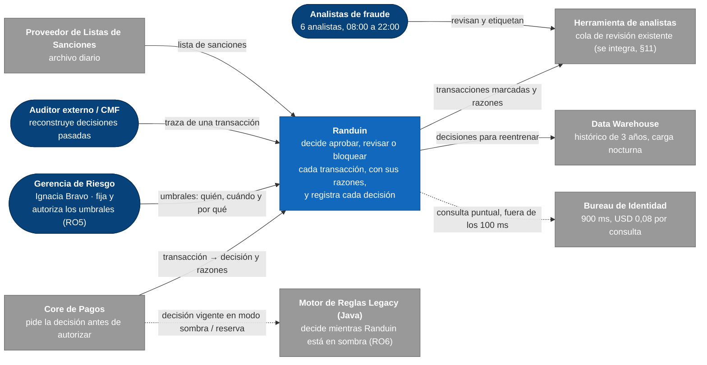
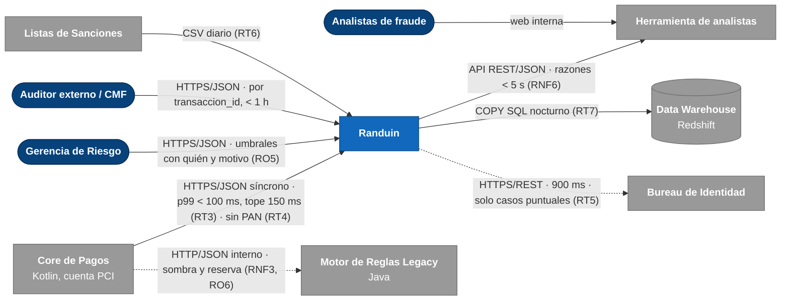
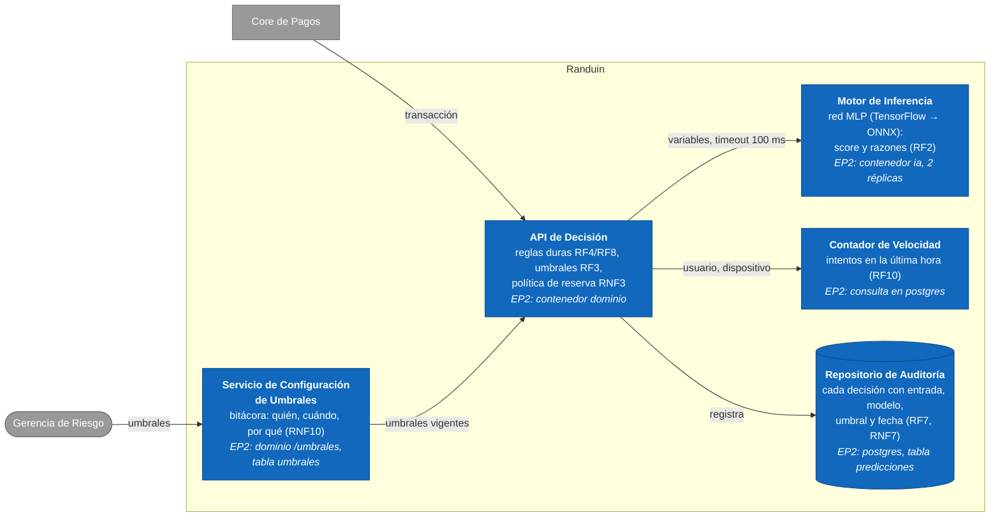
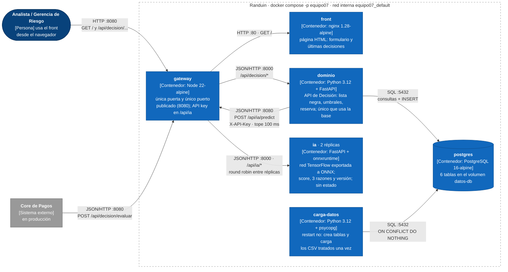
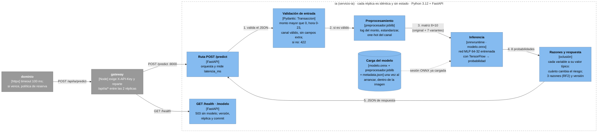
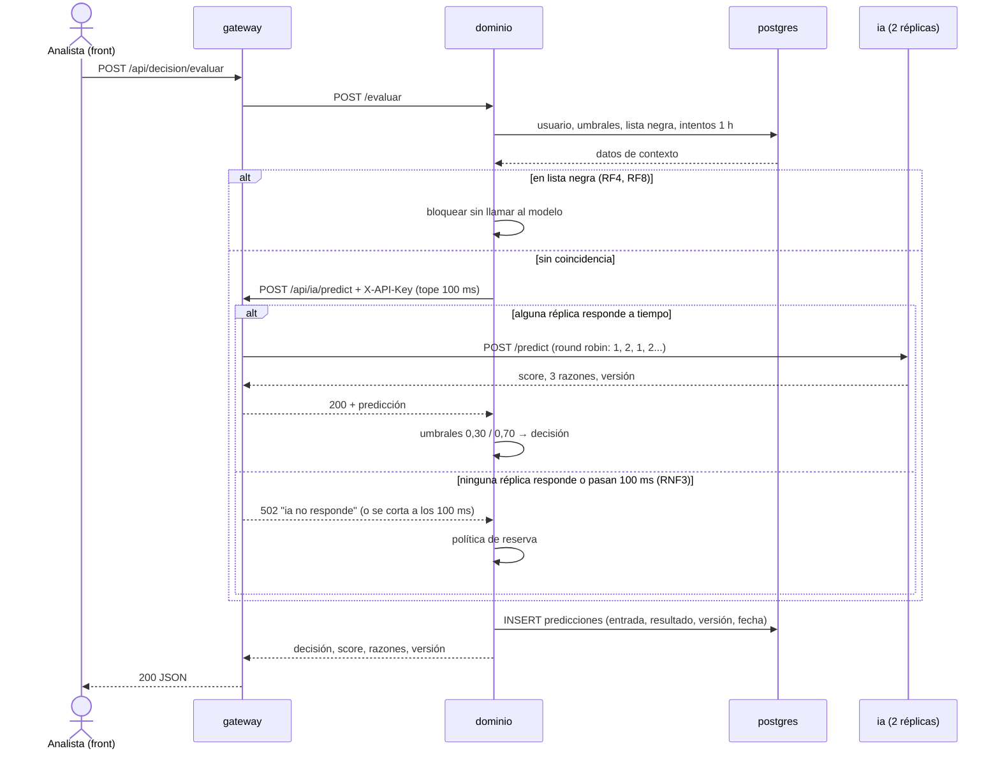
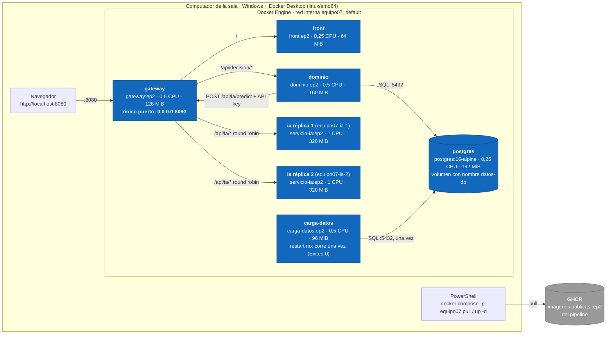
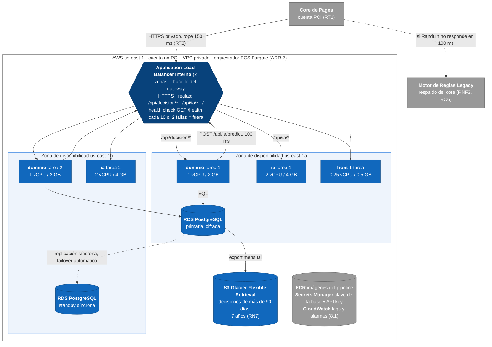
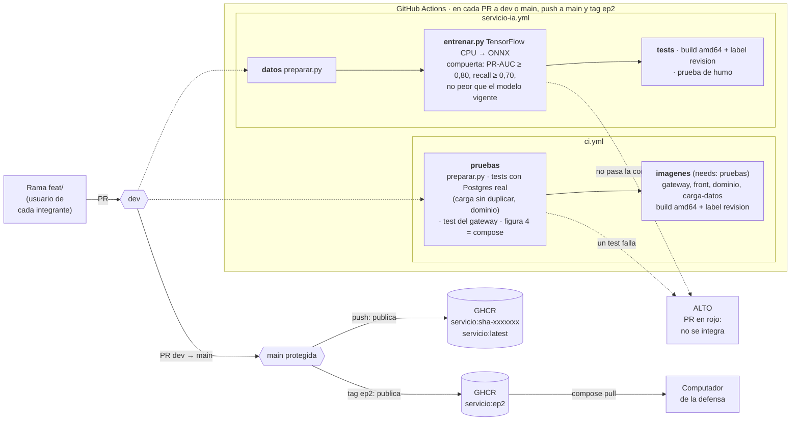
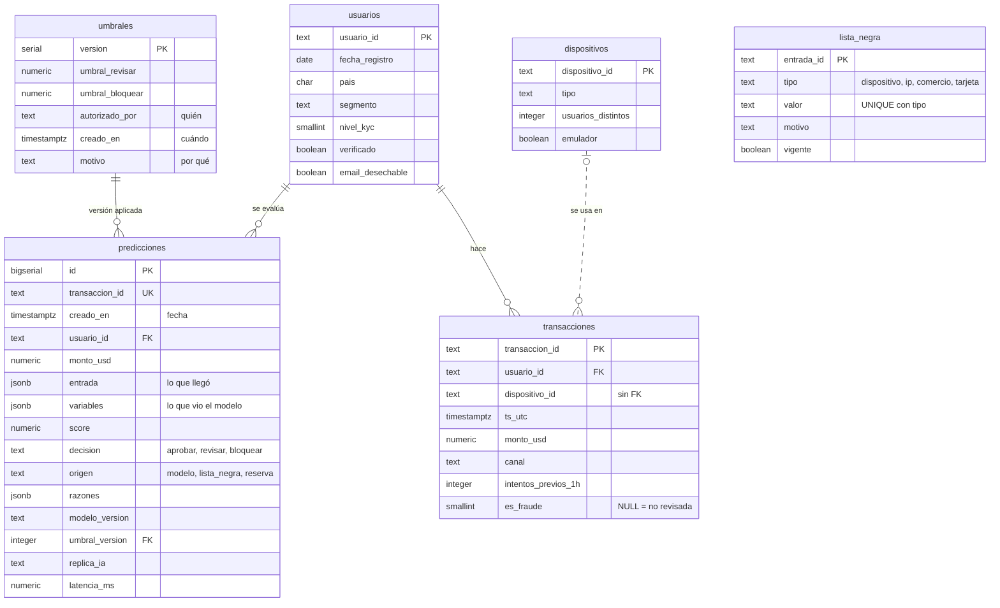

# Arquitectura de Randuin · figuras del arc42 (EP2)

Cada figura vive como código Mermaid (`.mmd`) y se versiona en el mismo pull request que el cambio que describe
(laboratorio L5). GitHub dibuja los bloques de abajo; las imágenes del informe están en `png/`.
La figura 4 tiene exactamente los mismos servicios que `compose.yaml` (nodos con la clase `cont`): lo comprueba
`docs/tests/test_figuras.py` en cada pull request.

Para regenerar una imagen después de editar su `.mmd` (misma letra y tamaño que las del informe):

```bash
npx -p @mermaid-js/mermaid-cli mmdc -i 04-contenedores.mmd -o png/04-contenedores.png -c mermaid-config.json -b white -s 2 -w 1500
```

| Figura | Capítulo | Archivo |
|---|---|---|
| Figura 1 · Contexto empresarial | 3.1 | [`01-contexto-empresarial.mmd`](01-contexto-empresarial.mmd) |
| Figura 2 · Contexto técnico: canales y protocolos | 3.2 | [`02-contexto-tecnico.mmd`](02-contexto-tecnico.mmd) |
| Figura 3 · Bloques de construcción, nivel 1 | 5.1 | [`03-bloques-nivel1.mmd`](03-bloques-nivel1.mmd) |
| Figura 4 · Contenedores (C4 nivel 2) = servicios del compose.yaml | 5.2 | [`04-contenedores.mmd`](04-contenedores.mmd) |
| Figura 5 · Componentes del microservicio ia (C4 nivel 3) | 5.3 | [`05-componentes-ia.mmd`](05-componentes-ia.mmd) |
| Figura 6 · Secuencia del flujo principal y camino de falla | 6 | [`06-secuencia.mmd`](06-secuencia.mmd) |
| Figura 7 · Despliegue actual (Docker Compose) | 7.1 | [`07-despliegue-actual.mmd`](07-despliegue-actual.mmd) |
| Figura 8 · Despliegue objetivo en AWS (2 zonas) | 7.1 | [`08-despliegue-objetivo.mmd`](08-despliegue-objetivo.mmd) |
| Figura 9 · Pipeline y gitflow | 7.4 | [`09-pipeline.mmd`](09-pipeline.mmd) |
| Figura 10 · Modelo de datos | 8.4 | [`10-modelo-datos.mmd`](10-modelo-datos.mmd) |

## Figura 1 · Contexto empresarial · cap. 3.1



## Figura 2 · Contexto técnico: canales y protocolos · cap. 3.2



## Figura 3 · Bloques de construcción, nivel 1 · cap. 5.1



## Figura 4 · Contenedores (C4 nivel 2) = servicios del compose.yaml · cap. 5.2



## Figura 5 · Componentes del microservicio ia (C4 nivel 3) · cap. 5.3



## Figura 6 · Secuencia del flujo principal y camino de falla · cap. 6



## Figura 7 · Despliegue actual (Docker Compose) · cap. 7.1



## Figura 8 · Despliegue objetivo en AWS (2 zonas) · cap. 7.1



## Figura 9 · Pipeline y gitflow · cap. 7.4



## Figura 10 · Modelo de datos · cap. 8.4


