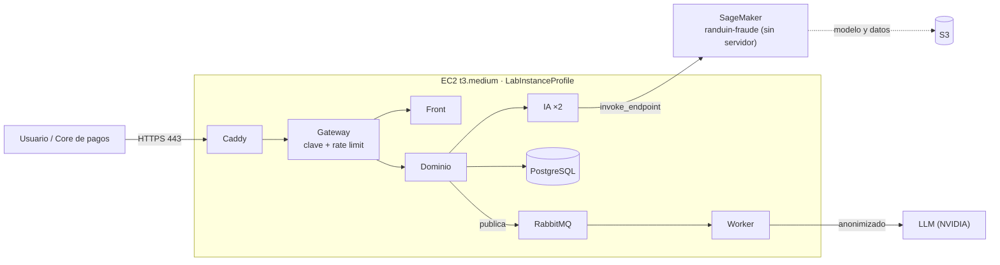

# 3. Plataforma, infraestructura y costos (IE4, IE5)

> Borrador para el informe de EP3. Mediciones del 21 de noviembre de 2026 sobre el sistema desplegado en AWS; precios consultados el mismo día (fuentes al final). Las capturas están en `docs/ep3/capturas/`.

## 3.1 Qué corre en AWS

| Pieza | Servicio | Detalle |
|---|---|---|
| Servidor | EC2 `t3.medium` (2 vCPU, 4 GB) | Corre todo en contenedores con Docker Compose: Caddy (HTTPS), gateway, front, dominio, 2 réplicas de IA, PostgreSQL, RabbitMQ y el worker. Rol `LabInstanceProfile`, sin claves de acceso. IP elástica fija. |
| Modelo | SageMaker, endpoint `randuin-fraude` (sin servidor) | Red neuronal 64-32 en TensorFlow Serving. 2 GB de memoria, concurrencia máxima 10. Versión: `randuin-fraude-20261119-172550`. |
| Dataset | S3 | Datos de entrenamiento y prueba, y el artefacto del modelo. |
| Cola | RabbitMQ (contenedor en la EC2) | Cola `llm` y cola de fallidos `llm.fallidos`. |
| Worker | Contenedor en la EC2 | Toma de la cola, anonimiza y llama al LLM. |
| LLM | API de NVIDIA (modelo provisorio) | Solo redacta el resumen; no está en el camino de la decisión. |

## 3.2 Cold start, medido dos veces

El endpoint es sin servidor: cuando pasa un rato sin uso baja a cero y la primera invocación levanta un contenedor.

| Medición | Dónde | Latencia |
|---|---|---|
| Primera invocación, al crear el endpoint | Desde CloudShell (Virginia) | **6.329 ms** (después, 71 ms) |
| Primera invocación tras más de 10 minutos sin uso | Desde la EC2 | **11.476 ms** (después, 45 y 41 ms) |

El cold start varía entre 6 y 11,5 s. Como el dominio espera solo 100 ms (`IA_TIMEOUT_MS`, para cumplir el corte de 150 ms de RNF3), una predicción que cae en frío sale por la **política de reserva** (origen `reserva`) y el cliente igual recibe respuesta. El contenedor queda caliente después de esa primera llamada.

Al subir la carga de golpe pasa algo parecido: SageMaker levanta contenedores nuevos y la latencia de sobrecarga (`OverheadLatency`) llega a unos 5 a 6 s al inicio de cada corrida (`sagemaker-latencia-maximo.png`). Es la explicación probable de buena parte de la reserva que vimos bajo carga (sección 5).

## 3.3 Evidencias de CloudWatch

- **Invocations:** ~2.000 por minuto en la corrida de 40 usuarios y ~4.800 por minuto en la de 110 usuarios, coherentes con lo que Locust reporta (`sagemaker-invocaciones.png`).
- **Errores 4XX y 5XX del endpoint:** cero durante todas las pruebas (`sagemaker-errores-latencia-modelo.png`).
- **ModelLatency:** ~1 a 2 ms por invocación en régimen estable. **OverheadLatency:** ~35 a 40 ms (`sagemaker-memoria-sobrecarga.png`).
- **Memoria del endpoint:** ~6,5 % de los 2 GB.
- **EC2:** CPU entre 14 % y 41 % en los puntos publicados (`ec2-cpu.png`).
- **Logs del microservicio:** `docker compose logs ia dominio gateway worker` en la EC2. Falta agregar una captura de esos registros.

## 3.4 Costo mensual al volumen del caso

El caso 3 da dos escenarios: **hoy, 200.000 transacciones diarias** (peak de 1.100 por minuto), y la **proyección de 1.000.000 diarias** (peak de 5.500 por minuto, ~92 por segundo), con 2,4 % marcadas para revisión. El tope de presupuesto es **USD 6.000 al mes** y RNF12 pide reportar el costo por millón de transacciones. Mes de 30 días; precios de la región us-east-1.

**Supuestos medidos.** Cada transacción hace una invocación a SageMaker de unos 40 ms (1 ms de modelo y ~35 ms de sobrecarga, medidos). Cada invocación mueve ~1,2 KB entre entrada y salida. Cada resumen del LLM usa ~250 tokens de entrada y ~80 de salida.

**Supuestos de dimensionamiento.** Hoy basta una `t3.medium`: aguanta el tráfico de 18 por segundo con margen. Para 92 por segundo se necesita más: en la prueba de carga la `t3.medium` empezó a saturarse cerca de 78 por segundo (p95 del dominio de 390 ms y 13,7 % de decisiones por reserva). Para la proyección se propone **dos `t3.xlarge`** (4 vCPU cada una; el doble de CPU por máquina y redundancia). Que alcance es un supuesto lineal, no medido: habría que repetir la prueba.

| Servicio | Hoy · 200.000 tx/día | Proyección · 1.000.000 tx/día |
|---|---|---|
| **EC2** | 1 × `t3.medium` (USD 0,0416/h): **30,37** | 2 × `t3.xlarge` (USD 0,1664/h): **242,94** |
| **SageMaker** (2 GB, 40 ms por invocación) | cómputo 9,60 + datos 0,12 = **9,72** | cómputo 48,00 + datos 0,58 = **48,58** |
| **S3** (~5 GB y pocas solicitudes) | **0,12** | **0,12** |
| **LLM** (referencia de pago: Nemotron 3.5 Lightning, USD 0,06 y 0,16 por millón de tokens) | 144.000 resúmenes: **4,00** | 720.000 resúmenes: **20,02** |
| **Total** | **≈ USD 44** | **≈ USD 312** |
| **Costo por millón de transacciones** (RNF12) | ≈ USD 7,4 | ≈ USD 10,4 |

Ambos escenarios quedan muy por debajo del tope de USD 6.000.

**Sensibilidad.** El resultado se mantiene aun con supuestos más pesimistas, para la proyección de 1.000.000:

| Variación | Efecto en el total mensual |
|---|---|
| SageMaker factura 100 ms por invocación en vez de 40 | +USD 72 (SageMaker: 120) → ≈ 384 |
| LLM con un modelo más caro: Claude Haiku 5.5 (USD 0,10 y 0,50) | +USD 27 → ≈ 339 |
| LLM premium: Claude Sonnet 5.5 (USD 2 y 10) | +USD 916 → ≈ 1.228 |

**Qué no está incluido:** disco EBS, la IPv4 pública, la transferencia de datos hacia internet y un balanceador de carga delante de las dos EC2. Son partidas pequeñas frente al total, pero habría que sumarlas en una estimación formal con la calculadora de AWS.

**Nota sobre el Learner Lab.** El costo real de las pruebas sale del crédito del laboratorio, no de dinero. Las pruebas de este informe (unas 20.000 invocaciones y unas decenas de llamadas al LLM) costaron menos de USD 1 en cómputo de SageMaker.

## 3.5 Fuentes y nivel de verificación de los precios

| Dato | Valor usado | Fuente | Verificación |
|---|---|---|---|
| SageMaker Serverless, 2 GB | USD 0,00004 por segundo | [Precios de Amazon SageMaker AI](https://aws.amazon.com/sagemaker-ai/pricing/) | Leído en un resumen de la página; la tabla oficial no se pudo leer completa. Confirmar en la calculadora de AWS. |
| SageMaker, datos procesados | USD 0,016 por GB | Misma página | Igual que el anterior. |
| SageMaker, memoria de 1 GB | Mitad que 2 GB | Cálculo proporcional | No verificado en la página. |
| EC2 `t3.medium` y `t3.xlarge` | USD 0,0416 y USD 0,1664 por hora (Linux) | [Precios de EC2 on-demand](https://aws.amazon.com/ec2/pricing/on-demand/) y [DoiT](https://www.doit.com/compute/spot/us-east-1/t3.xlarge) | Valores de un sitio tercero; coinciden con la tarifa pública. |
| S3 Standard | USD 0,023 por GB-mes | [Precios de Amazon S3](https://aws.amazon.com/s3/pricing/) | Varias fuentes terceras coinciden. |
| Claude Haiku 5.5 y Sonnet 5.5 | USD 0,10 y 0,50; USD 2 y 10 por millón de tokens | [Precios de Claude](https://platform.claude.com/docs/en/about-claude/pricing) | Leído de la página oficial. |
| Nemotron 3.5 Lightning | USD 0,06 y 0,16 por millón de tokens | [DeepInfra](https://deepinfra.com/pricing) | Leído de la página del proveedor. Es la referencia de pago más cercana al modelo provisorio. |

El modelo de NVIDIA que usamos es provisorio y no tiene precio público por token; cuando el docente publique el oficial, esta sección se recalcula.
